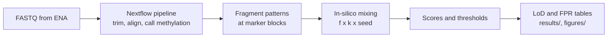

# cfdna-methylation-lod

How little tumour DNA can a cell-free DNA (cfDNA) methylation test detect in blood plasma?
This project measures the limit of detection (LoD) of a colorectal-cancer methylation
marker panel from public DNA methylation array data and plasma sequencing reads of healthy donors and cancer
patients.

## Key findings

**Question.** What is the lowest share of tumour DNA in plasma that a colorectal methylation
panel of 500 CpG sites detects in at least 95 % of tests, at a false-positive rate (FPR) of 5% or less?

**Design.** To determine LoD, I spiked-in a fraction (f) of tumour DNA into healthy cfDNA, then quantified
the lowest amount that scores below a detection threshold set on healthy samples only. The spike-ins are from a
colon-cancer cell line (HCT116) and cancer-patient plasma. The genomic backgrounds are plasma reads
of 30 healthy donors: 14 donors set every threshold and the other 16 serve only as test
backgrounds.

Terms used in the figure and tables below (more in [`docs/RESULTS.md`](docs/RESULTS.md#terms)):

| Term | Meaning |
|---|---|
| Tumour DNA at the markers | The share of informative fragments at the marker blocks that come from tumour DNA (the pre-registered effective share; times the tumour fraction for patient plasma). All figures use this scale. Nominal f, the share of all fragments, is about 4.6 times higher for HCT116 |
| FRAG | The main score: the count of fragments with 3 or more CpG calls that all match the tumour direction, in blocks that are negative in healthy plasma (Z-scored) |
| Ideal binomial model | The same tests, with reads redrawn as independent binomial calls. It shows the LoD without real-read effects |
| Censored | An LoD not reached at the top of the tested grid, so it is known only to lie above it |


**Figure 1.** (a) LoD at each step, on one scale: tumour DNA at the markers. Top: measured on
real reads. Bottom: idealised references. Bars: 95 % donor-bootstrap interval of the grid
points around the LoD; an arrow means the interval reaches above the grid top. Arrows alone:
censored LoDs, drawn from the grid top mapped to the markers. Diamonds: two other scores for
HCT116, on the same mapping as FRAG: a weighted Z score of block methylation (WZ) and the
share of fully methylated fragments. Open or grey: FPR above 5 %. In the simulation row, 7
more cells fail the FPR target and are left out. Grey band: 0.01–0.1 %, the target for
monitoring minimal residual disease (MRD), the tumour left after treatment. (b) Share of tests
detected at k = 1, tumour marker set, with 95 % donor-bootstrap bands. Left of the axis break:
the FPR at f = 0 with its 95 % interval. Dash-dot line: the LoD; shaded: the grid points
around it. Grey: fails the FPR target. Patient B is the only patient run with a finite LoD
(at k = 2); patients A and C stay censored (Figure S5). (c) Tumour-like spike-in fragments per
test. One HCT116 spike, mixed into the reads of each of the 16 test donors at k = 1, with 5
random seeds per donor: 80 tests per f. Points: mean; bars: standard deviation (SD) over the
80 tests; bars that reach the bottom of the axis extend to 0. Dashed line: the count at the
LoD. Scripts: `scripts/bootstrap_lod.py`, `scripts/key_findings_figure.py`. Variables: f, the spike-in fraction, is the share of all
fragments that come from the spike-in (f = 0 is a spike-free test). k, the pool size, is the
number of healthy donors whose reads form one background (k = 1 is one person's plasma, the
clinical case). TF, the tumour fraction, is the share of a patient's plasma cfDNA that comes
from the tumour.

**Measured on real reads** (FRAG score, tumour marker set; intervals: 95 % donor bootstrap)

| Spike-in | k | LoD, tumour DNA at the markers | 95 % interval | LoD, nominal f | Spike-free tests called positive (95 % upper bound) |
|---|---|---|---|---|---|
| HCT116 cell line | 1 | 2.15 % | 0.63 % to above the grid top (2.2 %) | 9.8 % | 0 of 16 (21 %) |
| HCT116 cell line | 2 | 2.01 % | 0.61–2.20 % | 9.2 % | 0 of 8 (37 %) |
| Plasma of 3 patients with measurable tumour DNA (A, B, C) | 1 | censored for all 3: above 2.6 %, 1.9 % and 0.47 % | – | above 10 % | 0 of 16 (21 %) |
| The same 3 patients | 2 | B: 1.81 %; A and C censored (above 2.5 % and 0.47 %) | B: 0.52 % to above the grid top | B: 9.7 %; A and C above 10 % | 0 of 8 (37 %) |

**Idealised references**

| Data | Spike-in | LoD, tumour DNA at the markers | Spike-free tests above threshold (95 % upper bound) |
|---|---|---|---|
| Real reads, ideal binomial model, k = 2 | HCT116 | 0.089 % (nominal f 0.45 %) | 0 of 8 (37 %) |
| Simulated reads, 100 or more reads per CpG | Colon-cancer plasma or colon cells | 1.2–3.0 %; 3 of 41 cells not reached by the 3 % top of the simulation grid | within the 5 % target (7 more cells fail it and are left out) |
| Arrays, best trained classifier | TCGA colorectal tumours | 0.9–1.7 % (7 random seeds) | 0 of 11 people (28 %) |

For patient plasma, this scale is the pre-registered tumour effective share (effective
share × tumour fraction). The pre-registered primary patient endpoint, LoD_tumour =
nominal-f LoD × tumour fraction, is in [`docs/RESULTS.md`](docs/RESULTS.md) (patient B, k = 2: 3.96 %). The spike-free tests
of the patient arm are the same tests as for HCT116, with the same
thresholds. In arrays and simulated reads, f is the tumour DNA share of every CpG, so it needs
no mapping.

With HCT116 cell-line DNA, 95 % detection needs at most about 2 % of marker fragments from
the tumour (between 0.6 % and 2.2 %). On real reads, every finite LoD lies between the
nominal grid points 3 % and 10 % (about 0.6 % and 2.2 % at the markers), so its exact value is
not known. The donor-bootstrap interval spans that whole gap, and at k = 1 it reaches above
the grid top. An LoD above the top of the grid is censored and given as a lower bound.

**How the LoD could improve.** At low spike-in levels, the number of tumour-like spike-in fragments
in a test varies widely from test to test (Figure 1c, error bars). For one HCT116 spike-in in the
16 test donors at k = 1, with 80 tests per level:

| Tumour DNA at the markers | Mean tumour-like spike-in fragments per test | SD | Tests with none |
|---|---|---|---|
| 0.01 % | 0.09 | 0.28 | 91 % |
| 0.07 % | 0.53 | 0.95 | 65 % |
| 0.21 % | 1.85 | 1.30 | 12.5 % |
| 0.63 % | 5.6 | 3.1 | 2.5 % |
| 2.2 % | 20.2 | 7.8 | 0 % |

Each one-person test holds about 1,600 informative fragments at the tumour markers. At the
LoD, about 20 are tumour-like spike-in fragments. Background differences between people dominate
the score's noise at this depth. At MRD levels a test would hold about one tumour fragment or
fewer, and most tests hold none, so MRD needs many more informative fragments, not only a
better score. To improve the LoD, model gains must
come from more healthy donors to set thresholds. This data can be used to derive a score that
models co-methylation within fragments and variation between people. This can also be used to discover markers that are consistent across tumor types for panel design.

### Dataset selection and possible changes to improve LoD

All data are public. Each source fills one role in the spike-in design.

| Source | Role | Why this source | Limit for the model |
|---|---|---|---|
| SPOT-MAS cfDNA (SRA PRJNA929650) | Healthy backgrounds | 30 healthy donors with whole-genome bisulfite reads: enough to keep threshold donors (14) apart from test donors (16) | About 15 million read pairs per donor (median; range 8–26 million). Only 16 spike-free tests at k = 1 and 8 at k = 2: an FPR of 0 of 16 has a 95 % upper bound of 21 % |
| HCT116 cell line (GSM8156741) | Tumour spike-in | A colon-cancer genome with whole-genome bisulfite reads and no normal-cell DNA | One cell line. HCT116 is CIMP-high, so it is more methylated at the markers than a typical tumour |
| Colorectal-cancer plasma (GSE186007) | Patient spike-in | Real patient cfDNA, with healthy runs from the same protocol as a control | 8 cancer runs; only 3 have tumour DNA measurable by copy number. A different library protocol from the backgrounds |
| TCGA-COAD arrays (GDC) | Marker selection | 276 tumours with purity of 0.6 or more | Markers come from tumour tissue. The patient run with the highest tumour fraction is rarely detected |
| Moss et al. 2018 arrays and atlas (GSE122126) | Idealised reference | A published plasma-dilution series to reproduce | 12 healthy blanks; array, not sequencing, data |

A better data set for this model would have:

| Change | Reason, from the results |
|---|---|
| More healthy donors, not more depth per donor | Between-person variation sets the floor; depth beyond 100 reads per CpG does not move the LoD in simulation |
| More cancer plasmas with an independent tumour fraction (for example tumour-informed) | Copy number finds tumour DNA in 3 of 8 runs only. Runs without copy-number changes cannot be placed on the tumour-DNA scale |
| Backgrounds and patient spikes from the same library protocol | Scored on their own, all 4 healthy runs of the other protocol are called on the atlas marker set, so that set does not transfer |
| More f grid points between 3 % and 10 % | Every finite LoD on real reads lies in that interval, so the grid cannot rank scores within it |
| More than one cell line | One CIMP-high line may overstate detection of typical tumours |

Full results per phase, all controls and the limitations: [`docs/RESULTS.md`](docs/RESULTS.md).

## Pipeline and how to run



### 1. Nextflow pipeline: reads to fragment patterns

The pipeline in `pipeline/` treats every sequencing source the same way:

1. Download or stream the FASTQ pair from ENA (`FETCH_ENA`, `FETCH_STREAM`).
2. Trim, and cap reads at 85 nt so that all sources match (`FASTP`).
3. Align to hg38 with bwa-meth and mark duplicates (`BWAMETH_ALIGN`).
4. Call methylation per CpG, with conversion-rate and M-bias checks (`METHYLDACKEL`).
5. Write fragment-level methylation patterns at the marker blocks (`BAM2PAT`, wgbstools).
6. Write one QC row per run, and fragment features for a batch control (`QC_TABLE`,
   `FRAG_FEATURES`).

Inputs: the sample sheet `pipeline/samples/phase5_samples.tsv` and the marker blocks in
`pipeline/markers/`. Outputs go to `$CFDNA_DATA/phase5/` (BAMs, pattern files, QC), outside
the repository. All options and profiles (`slurm`, `conda`, `apptainer`, `docker`,
`awsbatch`, `test`): [`pipeline/README.md`](pipeline/README.md).

```bash
uv sync                                   # Python 3.11, pinned by uv.lock
uv run pytest -q && uv run ruff check .   # tests and lint

# Smoke test (Docker, as in CI)
docker build -t cfdna-wgbstools:0.3.0 pipeline/containers/wgbstools
nextflow run pipeline/main.nf -profile test,docker

# Full run on Slurm
sbatch --export=ALL,REPO_DIR=$PWD,CFDNA_DATA=<data dir> scripts/phase5_nextflow.sbatch
```

Downloads go to `$CFDNA_DATA` (default `../cfdna-methylation-lod-data`), never into the
repository. The array downloads are in `data/`; verify them with
`cd "$CFDNA_DATA" && sha256sum -c <repo>/data/checksums.sha256`.

### 2. Downstream analysis: patterns to LoD

Run the scripts in this order. Each writes its tables to `results/phaseN/`. Steps 1–2 are
Phase 5 (the first real-read scores) and steps 3–7 are Phase 6 (the FRAG and WZ scores and
the patient-plasma spike).

| Step | Command | Output |
|---|---|---|
| 1. Train the transfer classifiers (needs the Phase 3b inputs, see below) | `uv run python scripts/phase5_transfer_train.py --features atlas` | transfer models |
| 2. Mix the HCT116 spike-in into donor pools, score, set thresholds on the 14 threshold donors | `uv run python scripts/phase5_score.py && uv run python scripts/phase5_summary.py` | `results/phase5/scores.tsv.gz`, `lod.tsv`, `detection.tsv` |
| 3. Fit the FRAG and WZ null model on the threshold donors and score their pools | `uv run python scripts/phase6_score.py --stage threshold` | `results/phase6/threshold_scores.tsv` |
| 4. Score the 16 test donors with the HCT116 spike-in | `uv run python scripts/phase6_score.py --stage eval` | `results/phase6/eval_scores.tsv.gz` |
| 5. Thresholds, detection, LoD and FPR | `uv run python scripts/phase6_summary.py` | `results/phase6/lod.tsv`, `detection.tsv`, `fpr.tsv` |
| 6. Tumour fraction of each patient run, from copy number | `uv run python scripts/phase6_tf.py tf <runs.tsv> <bins_dir> <gc.tsv> <out_dir>` | `tf.tsv` (committed as `results/phase6_gse/tf.tsv`) |
| 7. Patient-plasma spike: score and summarise | `uv run python scripts/phase6_gse_score.py && uv run python scripts/phase6_gse_summary.py` | `results/phase6_gse/lod_run.tsv`, `lod_summary.tsv` |
| 8. Donor bootstrap: intervals for detection, FPR and LoD | `uv run python scripts/bootstrap_lod.py` | `results/bootstrap/detection.tsv`, `lod.tsv`, `spike_fragments.tsv` |
| 9. Figures | `uv run python scripts/key_findings_figure.py && uv run python scripts/phase6_figures.py` | `figures/` |

The rules for Phase 6 were fixed before scoring in `pipeline/PREREGISTERED_PHASE6.md`. The
scoring script refuses to run if these rules or the scoring code are uncommitted or changed.
Every simulation and model uses a fixed seed.

The earlier phases (array reproduction, depth simulation and trained classifiers) have
their own scripts. Their commands are in
[`docs/RESULTS.md`](docs/RESULTS.md#earlier-phases-how-to-run), and a walk-through of the
array phases is in `notebooks/01_walkthrough.ipynb`.

## Repository layout

| Path | Contents |
|---|---|
| `pipeline/` | Nextflow pipeline, containers, sample sheet, markers, pre-registrations |
| `src/` | Library code: deconvolution, LoD, simulation, read mixing and scores, data readers |
| `scripts/` | One script per analysis step (`phase*_*.py`) and Slurm wrappers (`*.sbatch`) |
| `results/`, `figures/` | Summary tables and figures per phase |
| `docs/RESULTS.md` | Detailed methods, results per phase, controls and limitations |
| `data/` | Download scripts and checksums |
| `tests/` | pytest suite: deconvolution, LoD, simulation, leakage, read mixing, scores, tumour fraction |

## References

- Moss J, et al. Comprehensive human cell-type methylation atlas reveals origins of
  circulating cell-free DNA in health and disease. Nat Commun 9, 5068 (2018).
- Aran D, Sirota M, Butte AJ. Systematic pan-cancer analysis of tumour purity. Nat Commun 6,
  8971 (2015).
- Adalsteinsson VA, et al. Scalable whole-exome sequencing of cell-free DNA reveals high
  concordance with metastatic tumors. Nat Commun 8, 1324 (2017). (ichorCNA, the model for the
  tumour-fraction method.)
- CLSI EP17-A2. Evaluation of detection capability for clinical laboratory measurement
  procedures (2012).
