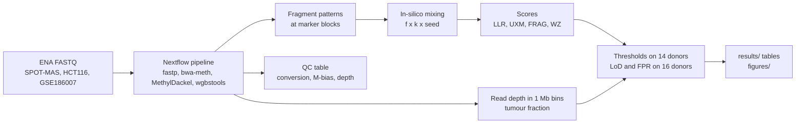

# cfdna-methylation-lod

How little tumour DNA can a cell-free DNA (cfDNA) methylation test detect in blood plasma?
This repository measures the limit of detection (LoD) of colorectal-cancer methylation
markers. It starts from public array data and ends with real sequencing reads from healthy
donors and cancer patients.

## Conclusion

| Question | Answer |
|---|---|
| Does the published plasma-dilution result hold? | Yes. The public arrays reproduce Moss et al. 2018, Fig. 7d (r = 0.940; the paper states 0.92). Under a clinical rule (CLSI EP17), 95 % detection needs about 2.0–2.3 % colon DNA. The paper's "down to 3 %" sits just below that LoD. |
| Does deeper sequencing help? | Not on its own. In simulation the LoD stays at 1.2–2.7 % from 100 reads per CpG up. Variation between healthy people sets the floor, not read counts. |
| Do trained classifiers help? | A little, and not reliably. Penalised logistic regression reaches 0.9–1.7 % on arrays, depending on the random seed. XGBoost does not beat it. |
| What happens with real reads? | The LoD rises by an order of magnitude. A colon-cancer cell line spiked into one healthy donor's reads needs about 9–10 % of the fragments for 95 % detection. An ideal binomial read model predicts under 1 %. |
| Does a better score close the gap? | No. The new FRAG score reaches the same LoD as the simple UXM fragment score, at a lower false-positive rate. A second new score, WZ, does no better. |
| Does real patient plasma behave like the cell line? | It is harder to detect. For one of three patient runs with measurable tumour DNA, 95 % detection is reached within the tested range (at k = 2 donors per background). On the tumour-DNA scale, the median LoD is at least 4 % at k = 1. |

The short version: with a 500-CpG colorectal marker panel and about 15 million read pairs
per healthy donor (median; range 8–26 million, `pipeline/samples/phase5_samples.tsv`), this kind of test detects a few per cent of tumour DNA, not the 0.01–0.1 % that
minimal residual disease (MRD) monitoring needs. Between-person variation in healthy
methylation and fragment-level effects are the limits, not sequencing depth.

## Terms

| Term | Meaning |
|---|---|
| cfDNA | Cell-free DNA: short DNA fragments that circulate in blood plasma |
| Blank | A healthy sample with no tumour DNA |
| Spike, spike-in | Tumour (or cancer-plasma) DNA mixed into a healthy background at a known fraction |
| f | Spike fraction: the share of DNA (array phases) or of fragments (read phases) that comes from the spike |
| Effective share | The share of fragments at the marker blocks that comes from the spike. It is lower than f, because the spike covers the markers less well |
| TF | Tumour fraction: the share of a patient's cfDNA that comes from the tumour, estimated from copy-number changes |
| LoD_tumour | LoD × TF: the LoD on the scale of tumour DNA, for a patient-plasma spike |
| LoB, limit of blank | The 95th percentile of a score over blanks (CLSI EP17-A2) |
| LoD, limit of detection | The lowest f detected in at least 95 % of tests, interpolated on log f |
| FPR | False-positive rate: the share of spike-free tests scored above the threshold. The target is 5 % or less |
| k | Pool size: the number of healthy donors whose reads form one background |
| Block | A 500 bp window around a marker CpG |
| Marker sets | "atlas": 5,258 CpGs of the Moss et al. 2018 cell-type atlas (3,550 blocks). "tumour": the top 500 TCGA colorectal-tumour CpGs (358 blocks) |
| NNLS | Non-negative least-squares deconvolution against the Moss atlas; gives a colon-cell share |
| LLR | Log-likelihood ratio of "tumour at fraction f" against "background only", summed over marker CpGs |
| UXM | Share of fragments with 3 or more CpG calls in a tumour block that are all methylated |
| FRAG | Count of fragments with 3 or more calls that all match the tumour direction, in blocks that are quiet in healthy plasma, minus the expected count, as a Z score |
| WZ | Weighted Z score of block methylation, with block weights from the variance between healthy donors |
| Censored | An LoD known only to lie above the top of the tested f range |

## Experimental design

### Data

All data are public. Downloads go to `$CFDNA_DATA` (default `../cfdna-methylation-lod-data`),
never into the repository.

| Source | Content | Used in |
|---|---|---|
| GEO GSE122126 (Moss et al. 2018) | EPIC arrays: 12 healthy cfDNA blanks, colon-cancer plasmas, the Fig. 7d dilution mixes | Phases 1–3b |
| `nloyfer/meth_atlas` (GitHub) | Reference atlas, 7,890 CpGs × 25 cell types | Phases 1–3b |
| GDC TCGA-COAD | 352 open-access 450K tumour and normal arrays; 276 tumours with purity ≥ 0.6 (Aran et al. 2015) | Phases 3b–6 (tumour markers) |
| SRA PRJNA929650 (SPOT-MAS) | Shallow whole-genome bisulfite cfDNA: 30 healthy donors and 10 early breast cancers | Phases 5–6 (backgrounds) |
| GEO GSM8156741 (SRR28401050) | HCT116 colon-cancer cell line, whole-genome bisulfite; first 20 M read pairs | Phases 5–6 (spike) |
| GEO GSE186007 (PRJNA771691) | Plasma cfDNA, LABS bisulfite protocol: 8 colorectal-cancer (CRC) and 4 healthy (HEA) runs; first 20 M read pairs each | Phase 6 (patient spike) |

The download scripts are in `data/` (for example `bash data/download_geo.sh`). Verify with
`cd "$CFDNA_DATA" && sha256sum -c <repo>/data/checksums.sha256`. The pipeline streams the
sequencing runs from ENA itself.

### Spike-in titration

Every phase uses the same idea: mix a known share f of tumour signal into healthy
backgrounds, then ask at which f a score crosses a threshold set on healthy samples only.

| Phase | Background | Spike | f grid |
|---|---|---|---|
| 1–2, arrays | 12 healthy EPIC blanks | Colon-cancer plasma pl806, or colon cells | 0–10 % |
| 3, simulation | Blank betas drawn as Binomial(D, beta) reads at depth D | Colon-cancer plasma or colon cells | 0–10 % |
| 3b, classifiers | Held-out blanks | 276 TCGA-COAD tumours | 0–10 % |
| 5–6, real reads | Pools of k = 1, 2, 4, 8 healthy SPOT-MAS donors | HCT116 fragments | 0, 0.1, 0.3, 1, 3, 10 % |
| 6, patient plasma | The same pools | Fragments of one GSE186007 run | 0, 0.1, 0.3, 1, 3, 10 % |

In the read phases, mixing is done on real fragments at the marker blocks, after duplicate
removal. f counts fragments in 2,000 random off-marker windows, so it does not depend on
marker coverage. Each condition has 5 random seeds per background pool.

### Controls and guards against bias

| Control | Purpose |
|---|---|
| Threshold donors vs eval donors | 14 healthy donors set every threshold and every fitted value. The other 16 donors serve only as test backgrounds. No eval donor is ever used to fit anything |
| Threshold rule | One-sided 95 % normal prediction bound over threshold-donor pools of the same k |
| Held-out FPR | Spike-free (f = 0) eval tests give the false-positive rate of each threshold |
| Ideal binomial rung | The same tests, with reads redrawn as independent binomial calls. It shows how much of the LoD is lost to real-read effects |
| Length-matched spike | HCT116 fragments chosen to match the insert sizes of plasma. It tests whether fragment length drives detection (it does not) |
| Healthy-plasma spikes (HEA) | The 4 healthy GSE186007 runs, spiked like the cancer runs. They test for a library-protocol effect |
| Batch control | A classifier on technical fragment features (insert size, mapping quality) checks for a spike-vs-background batch signal |
| Pre-registration | `pipeline/PREREGISTERED.md` and `pipeline/PREREGISTERED_PHASE6.md` fix the rules before scoring. The Phase 6 scoring script refuses to run if these files or the scoring code are uncommitted or changed |
| Leakage tests | No person or tumour is in both a training and a test fold. The tests fail on deliberate leaks |

## Workflow



### Nextflow pipeline (`pipeline/`)

The pipeline turns FASTQ files into fragment-level methylation patterns. Every source goes
through the same steps. Details and all options: [`pipeline/README.md`](pipeline/README.md).

| Stage | Does |
|---|---|
| `FETCH_ENA`, `FETCH_STREAM` | Download a FASTQ pair with MD5 check, or stream the first N read pairs |
| `FASTP` | Clip 15 nt from the R2 5′ end and the R1 3′ end; cap reads at 85 nt so that all sources match |
| `BWAMETH_INDEX`, `BWAMETH_ALIGN` | Build the hg38 index once; align, sort, mark duplicates |
| `BAM_CHECK` | Check each BAM, then delete its FASTQ files (on by default; `--keep_fastq` keeps them) |
| `METHYLDACKEL` | Per-CpG counts, M-bias, CHH conversion rate |
| `BAM2PAT`, `BLOCK_INDEX` | wgbstools fragment patterns in the marker and off-marker blocks |
| `FRAG_FEATURES` | Insert size, mapping quality, mismatches and read length (batch control) |
| `QC_TABLE` | One QC row per run |

Profiles: `slurm`, `conda`, `apptainer`, `docker`, `awsbatch`, `test`, `test_fastq`.

### How to run

```bash
uv sync                                   # Python 3.11, pinned by uv.lock
uv run pytest -q && uv run ruff check .   # tests and lint

# Phases 1-3b: arrays and simulation
bash data/download_geo.sh                 # and the other data/download_*.sh scripts
uv run python scripts/phase1_fig7d.py
uv run python scripts/phase2_lob_lod.py
REPO_DIR=$PWD CFDNA_DATA=<data dir> sbatch --array=0-42 scripts/phase3_depth_sim.sbatch
uv run python scripts/phase3_summary.py
REPO_DIR=$PWD CFDNA_DATA=<data dir> STEP=prepare sbatch scripts/phase3b.sbatch
REPO_DIR=$PWD CFDNA_DATA=<data dir> sbatch --array=0-15 scripts/phase3b.sbatch
uv run python scripts/phase3b_summary.py

# Phases 5-6: real reads
sbatch --export=ALL,REPO_DIR=$PWD,CFDNA_DATA=<data dir> scripts/phase5_nextflow.sbatch
uv run python scripts/phase5_transfer_train.py --features atlas
uv run python scripts/phase5_score.py && uv run python scripts/phase5_summary.py
uv run python scripts/phase6_score.py --stage threshold
uv run python scripts/phase6_score.py --stage eval && uv run python scripts/phase6_summary.py
uv run python scripts/phase6_tf.py tf <runs.tsv> <bins_dir> <gc.tsv> <out_dir>
uv run python scripts/phase6_gse_score.py && uv run python scripts/phase6_gse_summary.py
uv run python scripts/phase6_figures.py

# Pipeline smoke test (Docker, as in CI)
docker build -t cfdna-wgbstools:0.3.0 pipeline/containers/wgbstools
nextflow run pipeline/main.nf -profile test,docker
```

Every simulation and model uses a fixed seed (the `SEED` constant of each script).

### Inputs and outputs

| Path | Contents |
|---|---|
| `pipeline/samples/phase5_samples.tsv` | The 30 healthy donors (threshold or eval role) and 10 cancers |
| `pipeline/markers/` | Marker blocks (atlas, tumour) and off-marker windows |
| `$CFDNA_DATA/phase5/` | Pipeline outputs: BAMs, pat files, QC (not in the repository) |
| `results/phaseN/` | Summary tables per phase: `lod.tsv`, `detection.tsv`, `fpr.tsv` and controls |
| `figures/` | The figures below |
| `notebooks/01_walkthrough.ipynb` | A walk-through of Phases 1–3b from the summary tables |

## Results

### Phases 1–3: the array result and the depth simulation


Figure 1. Fig. 7d of Moss et al. 2018, reproduced from the public arrays. Left: NNLS colon
fraction against the share of cancer plasma in the mix. Right: observed against expected
colon fraction. All 8 points match the published figure within 0.15 percentage points.

| Phase | Result |
|---|---|
| 1, reproduce Fig. 7d | Match within 0.15 percentage points; r = 0.940 (paper: 0.92) |
| 2, array LoB and LoD | 95 % detection needs about 2.0–2.3 % colon DNA (about 3.0–3.4 % pl806 plasma) |
| 3, depth simulation | The LoD stays at 1.2–2.7 % from D = 100 reads per CpG up |


Figure 2. LoD against simulated depth D. Top row: blank HI1 included. Bottom row: HI1
removed. Left: plasma spike. Middle: colon-cell spike. Right: LLR on all markers with an
input cap, under an earlier pooled threshold rule. Open circles: FPR above 5 %, so that LoD
is not valid. Dotted "control" lines: no between-person variation. Without between-person
variation, the LoD falls with depth. With real blanks, it stays flat.

### Phase 3b: trained classifiers against untrained scores

TCGA-COAD tumours are spiked into held-out blanks. HI1 is excluded from these values; with
HI1, no model meets the 5 % FPR target.

| Model | LoD, % tumour-cell DNA | Held-out false positives |
|---|---|---|
| Logistic regression, L1 penalty, array | 1.6 at the fixed seed; 0.9–1.7 across 7 seeds | 0 of 11 people |
| NNLS, array and reads from D = 100 up | 1.9–2.0 | within the 5 % target |
| Trained models, reads from D = 100 up | 2.2–3.4 | see `results/phase3b/lod.tsv` |

XGBoost does not beat logistic regression consistently (largest AUC gap +0.07). Part of its
gain on tumour features is colon-tissue signal: TCGA normal-colon spikes are called too.


Figure 3. Sensitivity against f, HI1 excluded. Top row: atlas features. Bottom row: tumour
features selected inside each training fold. Columns: array betas, then simulated reads at
D = 30, 100 and 300. Bands: 95 % bootstrap interval over people. Dashed lines with open
markers: held-out FPR above 5 %. Dotted line: 95 %.

### Phases 5–6: real reads, cell-line spike

HCT116 fragments are mixed into pools of real healthy SPOT-MAS reads. Values are for the
tumour marker set (`results/phase5/lod.tsv`, `results/phase6/lod.tsv`).


Figure 4. Share of tests detected against spike fraction f, tumour marker set, k = 1 and 2
donors per background. Solid lines: real reads. Dashed line: the same tests with reads
redrawn as ideal binomial calls (LLR_binom only). Dotted line: 95 %. UXM, WZ and LLR_binom
exceed the 5 % FPR target at k = 1 (2 of 16 spike-free tests), and UXM at k = 2 (1 of 8).
Their curves therefore start above 0. The ideal-binomial rung also exceeds it at k = 1
(4 of 16). At k = 2, the WZ (squares) and FRAG curves coincide.

| Score | k | LoD, nominal f | LoD, effective share | Eval FPR |
|---|---|---|---|---|
| LLR_binom, ideal binomial reads | 2 | 0.45 % | – | 0 of 8 |
| LLR_binom, real reads | 1 and 2 | not reached at f ≤ 10 % | – | 2 of 16; 0 of 8 |
| UXM (Phase 5) | 1 | 9.1 % | – | 2 of 16 |
| UXM (Phase 5) | 2 | 7.4 % | – | 1 of 8 |
| FRAG (Phase 6) | 1 | 9.8 % | 2.15 % | 0 of 16 |
| FRAG (Phase 6) | 2 | 9.2 % | 2.01 % | 0 of 8 |
| WZ (Phase 6) | 1 | not reached at f ≤ 10 % | – | 2 of 16 |
| WZ (Phase 6) | 2 | 9.2 % | 1.60 % (share of CpG calls) | 0 of 8 |

- Real reads cost more than an order of magnitude against the binomial model. Both runs use
  the same calls per block, so the gap comes from the real fragments: co-methylation within a
  fragment and between-person variation. `results/phase5/gap_attribution.tsv` splits it.
- FRAG reaches the same LoD as UXM at a lower FPR. Every finite LoD lies between the grid
  points 3 % and 10 %, so the grid cannot rank scores within that interval.
  WZ at k = 1 does not reach 95 % at f ≤ 10 %.
- With every score's threshold set at its highest spike-free eval score (matched FPR,
  `results/phase6/matched.tsv`), the LoDs are UXM 9.7 % and 8.3 %, FRAG 9.7 % and 7.7 %, at
  k = 1 and 2. The scores stay within the same grid interval.
- The length-matched spike detects like the full spike at f = 3 % (tumour set, k = 1 and 2:
  0.28–0.43 vs 0.29–0.30). Fragment length does not drive detection. It has too few
  fragments to test f = 10 %.
- Other Phase 6 tables: `fpr.tsv`, `effective_share.tsv` and `effective_share_mean.tsv`
  (spike share per test), `confound_calls.tsv` (calls per fragment, spike vs donors),
  `unscored.tsv` (cells without enough length-matched fragments), `external.tsv`. The file
  `eval_run_sha.txt` names the commit of the scoring code.
- The 10 breast cancers are not separated from healthy donors (AUC 0.36–0.45). The markers
  come from colorectal tumours, so this check has little power. It is not a positive control.

### Phase 6: real reads, patient-plasma spike

Each GSE186007 run is spiked into the same pools as HCT116. TF comes from arm-level copy
number in 1 Mb read-depth bins (`scripts/phase6_tf.py`).

| Run | Group | TF | Altered chromosome arms |
|---|---|---|---|
| SRR24725517 | CRC | 0.60 | 18 |
| SRR24725519 | CRC | 0.41 | 22 |
| SRR24725520 | CRC | 0.10 (95 % interval includes 0) | 1 |
| 5 other CRC runs | CRC | 0 | 0 |
| 4 runs | HEA | 0 | 0 |


Figure 5. Share of tests detected against f for each GSE186007 run used as the spike. FRAG
score, tumour marker set, bound threshold rule, k = 1 and 2. Coloured: CRC runs with TF above
0. Grey: CRC runs with TF 0. Dashed: healthy runs. Dotted line: 95 %.

Primary endpoint: FRAG, tumour set, the 3 CRC runs with TF above 0
(`results/phase6_gse/lod_run.tsv`, `lod_summary.tsv`).

| k | Runs with a finite LoD | SRR24725519 LoD (f) | Median LoD_tumour over the 3 runs | HCT116 effective share at LoD |
|---|---|---|---|---|
| 1 | 0 of 3 | above 10 % (censored) | at least 4.09 % (all 3 censored) | 2.15 % |
| 2 | 1 of 3 | between 3 % and 10 % | at least 1.2 % (2 of 3 censored; 3.96 % with the interpolated LoD) | 2.01 % |

- At k = 2, SRR24725519 jumps from 1 of 40 tests detected at f = 3 % to 39 of 40 at f = 10 %
  (95 % interval 0.87–1.00). The LoD can lie anywhere between those grid points. The value
  interpolated on log f is 9.7 % (LoD_tumour 3.96 %). Only the grid bracket is
  certain, so the median over the 3 runs is bounded below by 0.03 × TF 0.409 = 1.2 %. Its effective
  share at the LoD is at most 1.88 %. So the patient run and HCT116 cannot be told apart.
- SRR24725517 has the highest TF but is rarely detected. Its reads cover the tumour blocks
  as well as SRR24725519, so depth is not the cause. Its tumour may not share the methylation
  pattern of the TCGA-derived markers.
- Healthy-plasma spikes are never detected with FRAG, at any k or f. The protocol difference
  (LABS vs SPOT-MAS) does not create false tumour signal on the tumour set.
- Scored on their own, without a background, the runs separate partly on the tumour set:
  FRAG calls 2 of 8 CRC and 0 of 4 HEA (95 % upper bound 0.60), AUC 0.875. On the atlas set,
  all 4 healthy runs are called. That is a protocol effect, so the atlas set does not transfer
  between protocols.

## Limitations

- **Few people.** Every FPR rests on 16 spike-free eval tests at k = 1 and 8 at k = 2. For 0
  of 16, the 95 % interval reaches 21 % (`fpr_hi95` in `results/phase6/lod.tsv`). The array phases rest on 11 people in 7 groups.
- **Coarse f grid.** Between 3 % and 10 % there is no grid point. An interpolated LoD in that
  range carries false precision.
- **Censored LoDs.** In the patient arm most LoDs lie above the top of the grid. Medians are
  therefore given as lower bounds.
- **One cell line.** HCT116 is CIMP-high, so it is more methylated at these markers than a
  typical colon tumour. Detection of typical tumours may be worse.
- **TF from copy number only.** Runs without copy-number changes get TF 0 even if they carry
  tumour DNA. The TF of SRR24725520 rests on one arm.
- **f differs between phases.** Phases 2–3 spike colon plasma or colon cells; Phase 3b spikes
  TCGA tumour cells; Phases 5–6 spike fragments.
- **Array processing.** TCGA betas (SeSAMe) and GEO betas (minfi) are processed differently.
  The median offset at the atlas CpGs is 0.028.

## Repository layout

| Path | Contents |
|---|---|
| `data/` | Download scripts and checksums |
| `src/deconv.py`, `src/lod.py` | NNLS deconvolution; LoB and LoD (CLSI EP17-A2) |
| `src/simulate.py`, `src/classify.py` | Read simulation and LLR; tumour spikes, grouped folds, AUC |
| `src/phase5.py`, `src/phase6.py` | Read-level mixing and scores (LLR, UXM, FRAG, WZ) |
| `src/atlas.py`, `src/geo.py`, `src/tcga.py`, `src/spotmas.py` | Data readers |
| `pipeline/` | Nextflow pipeline, containers, sample sheet, markers, pre-registrations |
| `scripts/` | One script per analysis step (`phase*_*.py`) and Slurm wrappers (`*.sbatch`) |
| `results/`, `figures/` | Summary tables and figures per phase |
| `tests/` | pytest suite: deconvolution, LoD, simulation, leakage, read mixing, scores, TF |

## References

- Moss J, et al. Comprehensive human cell-type methylation atlas reveals origins of
  circulating cell-free DNA in health and disease. Nat Commun 9, 5068 (2018).
- Aran D, Sirota M, Butte AJ. Systematic pan-cancer analysis of tumour purity. Nat Commun 6,
  8971 (2015).
- Adalsteinsson VA, et al. Scalable whole-exome sequencing of cell-free DNA reveals high
  concordance with metastatic tumors. Nat Commun 8, 1324 (2017). (ichorCNA, the model for the
  TF method.)
- CLSI EP17-A2. Evaluation of detection capability for clinical laboratory measurement
  procedures (2012).
