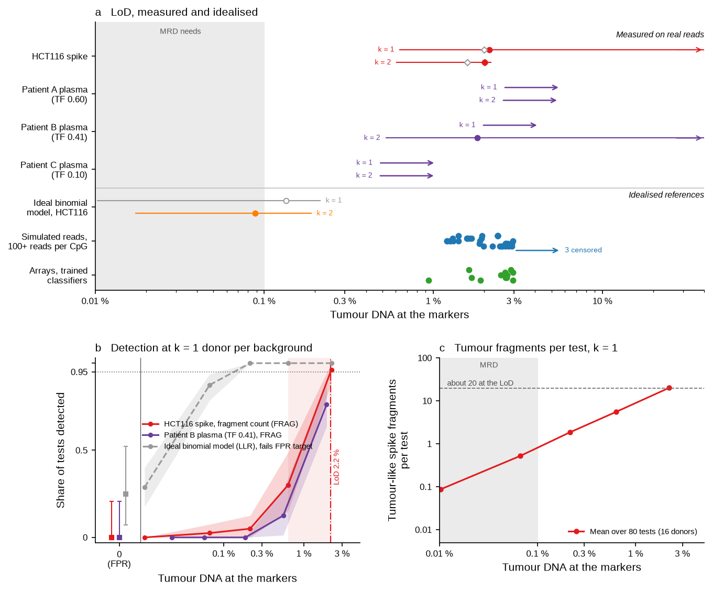
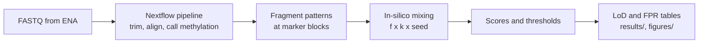

# cfdna-methylation-lod

How little tumour DNA can a cell-free DNA (cfDNA) methylation test detect in blood plasma?
This repository measures the limit of detection (LoD) of a colorectal-cancer methylation
marker panel, from public array data to real sequencing reads of healthy donors and cancer
patients.

## Key findings

**Question.** What is the lowest share of tumour DNA in plasma that a 500-CpG colorectal
methylation panel detects in at least 95 % of tests, at a false-positive rate (FPR) of 5 %
or less?

**Design.** We mix a known spike fraction f of tumour signal into healthy cfDNA, then find
the lowest f that scores above a threshold set on healthy samples only. The spikes are a
colon-cancer cell line (HCT116) and cancer-patient plasma. The backgrounds are real reads
of 30 healthy donors: 14 donors set every threshold and the other 16 serve only as test
backgrounds. Array data and simulated reads give the idealised reference.



**Figure 1.** (a) LoD at each step, from idealised to real data. Each dot is one score,
marker set or donor-pool size (k). Open dots: FPR above 5 %. Purple bar: the one patient
run whose LoD lies between the grid points 3 % and 10 %. Arrows: censored LoDs, not reached
at the top of the tested f grid, so each is only known to lie above it. The grid top is 3 %
for the simulation (blue arrows) and 10 % for real reads (purple arrows, dashed line). In the
simulation row, 7 more cells fail the FPR target and are left out. Grey band:
0.01–0.1 %, the level that minimal residual disease (MRD) monitoring needs. f is the share
of DNA (arrays, simulation) or of fragments (real reads). (b) Share of tests detected
against f, k = 2 donors per background, tumour marker set. Dotted line: 95 %.
Script: `scripts/key_findings_figure.py`.

| Data | Spike | LoD (f at 95 % detection) | Spike-free tests above threshold |
|---|---|---|---|
| Arrays, best trained classifier | TCGA colorectal tumours | 0.9–1.7 % (7 random seeds) | 0 of 11 people |
| Simulated reads, 100 or more reads per CpG | Colon-cancer plasma or colon cells | 1.2–3.0 %; 3 of 41 cells not reached by the 3 % top of the simulation grid | within the 5 % target (7 more cells fail it and are left out) |
| Real reads, ideal binomial model, k = 2 | HCT116 | 0.45 % | 0 of 8 |
| Real reads, FRAG score, k = 1 and 2 | HCT116 | 9.8 % and 9.2 % (effective share 2.15 % and 2.01 %) | 0 of 16 and 0 of 8 |
| Real reads, FRAG score, k = 1 | Plasma of 3 patients with measurable tumour DNA | above 10 % for all 3 runs; median tumour-DNA scale at least 4.09 % | – |
| Real reads, FRAG score, k = 2 | The same 3 patients | 1 run between 3 % and 10 %, 2 above 10 %; median tumour-DNA scale at least 1.2 % (3.96 % if interpolated) | – |

The test detects a few per cent of tumour DNA, not the 0.01–0.1 % that MRD monitoring
needs. On real reads, every finite LoD lies between the grid points 3 % and 10 %, so its
exact value is not known. An LoD above the top of the grid (10 %) is censored and given as a
lower bound.

**How the LoD could improve.** Deeper sequencing alone will not help: in simulation the LoD
is flat from 100 reads per CpG up, and real reads lose more than tenfold against an ideal
binomial model with the same calls (9.2 % against 0.45 %). To improve the LoD, model gains must
come from more healthy donors to set thresholds. This data can be used to derive a score that
models co-methylation within fragments and variation between people and discover markers that are consistent across tumor types.

### The data, how they were selected, and how they could be better

All data are public. Each source fills one role in the spike-in design.

| Source | Role | Why this source | Limit for the model |
|---|---|---|---|
| SPOT-MAS cfDNA (SRA PRJNA929650) | Healthy backgrounds | 30 healthy donors with whole-genome bisulfite reads: enough to keep threshold donors (14) apart from test donors (16) | About 15 million read pairs per donor (median; range 8–26 million). Only 16 spike-free tests at k = 1 and 8 at k = 2: an FPR of 0 of 16 has a 95 % upper bound of 21 % |
| HCT116 cell line (GSM8156741) | Tumour spike | A colon-cancer genome with whole-genome bisulfite reads and no normal-cell DNA | One cell line. HCT116 is CIMP-high, so it is more methylated at the markers than a typical tumour |
| Colorectal-cancer plasma (GSE186007) | Patient spike | Real patient cfDNA, with healthy runs from the same protocol as a control | 8 cancer runs; only 3 have tumour DNA measurable by copy number. A different library protocol from the backgrounds |
| TCGA-COAD arrays (GDC) | Marker selection | 276 tumours with purity of 0.6 or more | Markers come from tumour tissue. The patient run with the highest tumour fraction is rarely detected |
| Moss et al. 2018 arrays and atlas (GSE122126) | Idealised reference | A published plasma-dilution series to reproduce | 12 healthy blanks; array, not sequencing, data |

A better data set for this model would have:

| Change | Reason, from the results |
|---|---|
| More healthy donors, not more depth per donor | Between-person variation sets the floor; depth beyond 100 reads per CpG does not move the LoD in simulation |
| More cancer plasmas with an independent tumour fraction (for example tumour-informed) | Copy number finds tumour DNA in 3 of 8 runs only. Runs without copy-number changes cannot be placed on the tumour-DNA scale |
| Backgrounds and patient spikes from the same library protocol | Scored on their own, all 4 healthy runs of the other protocol are called on the atlas marker set, so that set does not transfer |
| More f grid points between 3 % and 10 % | Every finite LoD on real reads lies in that interval, so the grid cannot rank scores within it |
| More than one cell line | One CIMP-high line may overstate detection of typical tumours |

Full results per phase, all controls and the limitations: [`docs/RESULTS.md`](docs/RESULTS.md).

## Terms

| Term | Meaning |
|---|---|
| cfDNA | Cell-free DNA: short DNA fragments that circulate in blood plasma |
| f | Spike fraction: the share of DNA (array phases) or of fragments (read phases) that comes from the spike |
| LoD | Limit of detection: the lowest f detected in at least 95 % of tests, interpolated on log f |
| FPR | False-positive rate: the share of spike-free tests scored above the threshold. The target is 5 % or less |
| k | Pool size: the number of healthy donors whose reads form one background |
| Effective share | The share of fragments at the marker blocks that comes from the spike. It is lower than f, because the spike covers the markers less well |
| Tumour-DNA scale | LoD × tumour fraction: the LoD expressed as a share of tumour DNA, for a patient-plasma spike |
| FRAG | Count of fragments with 3 or more CpG calls that all match the tumour direction, in blocks that are quiet in healthy plasma, as a Z score |
| Ideal binomial model | The same tests, with reads redrawn as independent binomial calls. It shows the LoD without real-read effects |
| Censored | An LoD known only to lie above the top of the tested f range |

More terms: [`docs/RESULTS.md`](docs/RESULTS.md#terms).

## Pipeline and how to run



### 1. Nextflow pipeline: reads to fragment patterns

The pipeline in `pipeline/` treats every sequencing source the same way:

1. Download or stream the FASTQ pair from ENA (`FETCH_ENA`, `FETCH_STREAM`).
2. Trim, and cap reads at 85 nt so that all sources match (`FASTP`).
3. Align to hg38 with bwa-meth and mark duplicates (`BWAMETH_ALIGN`).
4. Call methylation per CpG, with conversion-rate and M-bias checks (`METHYLDACKEL`).
5. Write fragment-level methylation patterns at the marker blocks (`BAM2PAT`, wgbstools).
6. Write one QC row per run, and fragment features for a batch control (`QC_TABLE`,
   `FRAG_FEATURES`).

Inputs: the sample sheet `pipeline/samples/phase5_samples.tsv` and the marker blocks in
`pipeline/markers/`. Outputs go to `$CFDNA_DATA/phase5/` (BAMs, pattern files, QC), outside
the repository. All options and profiles (`slurm`, `conda`, `apptainer`, `docker`,
`awsbatch`, `test`): [`pipeline/README.md`](pipeline/README.md).

```bash
uv sync                                   # Python 3.11, pinned by uv.lock
uv run pytest -q && uv run ruff check .   # tests and lint

# Smoke test (Docker, as in CI)
docker build -t cfdna-wgbstools:0.3.0 pipeline/containers/wgbstools
nextflow run pipeline/main.nf -profile test,docker

# Full run on Slurm
sbatch --export=ALL,REPO_DIR=$PWD,CFDNA_DATA=<data dir> scripts/phase5_nextflow.sbatch
```

Downloads go to `$CFDNA_DATA` (default `../cfdna-methylation-lod-data`), never into the
repository. The array downloads are in `data/`; verify them with
`cd "$CFDNA_DATA" && sha256sum -c <repo>/data/checksums.sha256`.

### 2. Downstream analysis: patterns to LoD

Run the scripts in this order. Each writes its tables to `results/phaseN/`. Steps 1–2 are
Phase 5 (the first real-read scores) and steps 3–7 are Phase 6 (the FRAG and WZ scores and
the patient-plasma spike).

| Step | Command | Output |
|---|---|---|
| 1. Train the transfer classifiers (needs the Phase 3b inputs, see below) | `uv run python scripts/phase5_transfer_train.py --features atlas` | transfer models |
| 2. Mix the HCT116 spike into donor pools, score, set thresholds on the 14 threshold donors | `uv run python scripts/phase5_score.py && uv run python scripts/phase5_summary.py` | `results/phase5/scores.tsv.gz`, `lod.tsv`, `detection.tsv` |
| 3. Fit the FRAG and WZ null model on the threshold donors and score their pools | `uv run python scripts/phase6_score.py --stage threshold` | `results/phase6/threshold_scores.tsv` |
| 4. Score the 16 test donors with the HCT116 spike | `uv run python scripts/phase6_score.py --stage eval` | `results/phase6/eval_scores.tsv.gz` |
| 5. Thresholds, detection, LoD and FPR | `uv run python scripts/phase6_summary.py` | `results/phase6/lod.tsv`, `detection.tsv`, `fpr.tsv` |
| 6. Tumour fraction of each patient run, from copy number | `uv run python scripts/phase6_tf.py tf <runs.tsv> <bins_dir> <gc.tsv> <out_dir>` | `tf.tsv` (committed as `results/phase6_gse/tf.tsv`) |
| 7. Patient-plasma spike: score and summarise | `uv run python scripts/phase6_gse_score.py && uv run python scripts/phase6_gse_summary.py` | `results/phase6_gse/lod_run.tsv`, `lod_summary.tsv` |
| 8. Figures | `uv run python scripts/key_findings_figure.py && uv run python scripts/phase6_figures.py` | `figures/` |

The rules for Phase 6 were fixed before scoring in `pipeline/PREREGISTERED_PHASE6.md`. The
scoring script refuses to run if these rules or the scoring code are uncommitted or changed.
Every simulation and model uses a fixed seed.

The earlier phases (array reproduction, depth simulation and trained classifiers) have
their own scripts. Their commands are in
[`docs/RESULTS.md`](docs/RESULTS.md#earlier-phases-how-to-run), and a walk-through of the
array phases is in `notebooks/01_walkthrough.ipynb`.

## Repository layout

| Path | Contents |
|---|---|
| `pipeline/` | Nextflow pipeline, containers, sample sheet, markers, pre-registrations |
| `src/` | Library code: deconvolution, LoD, simulation, read mixing and scores, data readers |
| `scripts/` | One script per analysis step (`phase*_*.py`) and Slurm wrappers (`*.sbatch`) |
| `results/`, `figures/` | Summary tables and figures per phase |
| `docs/RESULTS.md` | Detailed methods, results per phase, controls and limitations |
| `data/` | Download scripts and checksums |
| `tests/` | pytest suite: deconvolution, LoD, simulation, leakage, read mixing, scores, tumour fraction |

## References

- Moss J, et al. Comprehensive human cell-type methylation atlas reveals origins of
  circulating cell-free DNA in health and disease. Nat Commun 9, 5068 (2018).
- Aran D, Sirota M, Butte AJ. Systematic pan-cancer analysis of tumour purity. Nat Commun 6,
  8971 (2015).
- Adalsteinsson VA, et al. Scalable whole-exome sequencing of cell-free DNA reveals high
  concordance with metastatic tumors. Nat Commun 8, 1324 (2017). (ichorCNA, the model for the
  tumour-fraction method.)
- CLSI EP17-A2. Evaluation of detection capability for clinical laboratory measurement
  procedures (2012).
