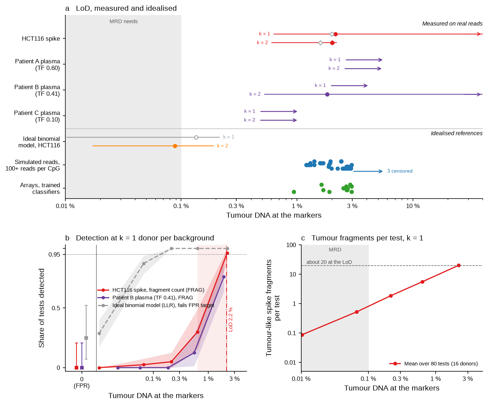
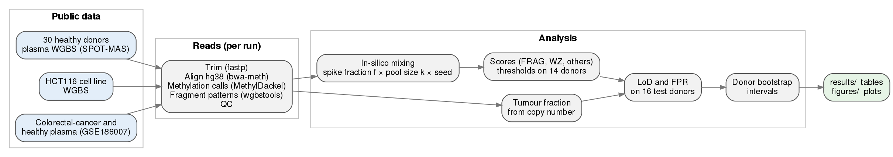

# cfdna-methylation-lod

How little tumour DNA can a cell-free DNA (cfDNA) methylation test detect in blood plasma?
In this project, I measure the limit of detection (LoD) of a 500-CpG colorectal-cancer marker panel.
I use previously published plasma sequencing reads of healthy donors and cancer patients and
DNA methylation array data.

## Key findings

**Design.** To determine LoD, I mixed Tumour DNA in silico into the plasma reads of healthy donors at a
fraction f. I called LoD as the lowest f detected in at least 95 % of tests, at a false-positive
rate (FPR) of 5 % or less. The tumour DNA I tested comes from a colon-cancer cell line (HCT116) or from
cancer-patient plasma. Of 30 healthy donors, 14 were used to set the detection threshold and 16 served as
test backgrounds.



**Figure 1.** (a) LoD of each score and data set, on one scale: the share of marker fragments
that come from tumour DNA. (b) Detection rate and (c) tumour fragments per test for one
HCT116 spike in one person's plasma. Detailed findings: [`docs/RESULTS.md`](docs/RESULTS.md#figure-1); terms: [`docs/RESULTS.md`](docs/RESULTS.md#terms).

LoD on real reads, main score (FRAG), as the share of marker fragments from tumour DNA.
Intervals: 95 % bootstrap over donors. k is the number of donors pooled into one test
(k = 1 is one person's plasma).

| Spike-in | k | LoD | 95 % interval | Spike-free tests called positive (95 % upper bound) |
|---|---|---|---|---|
| HCT116 cell line | 1 | 2.15 % | 0.63 % to above 2.2 % | 0 of 16 (21 %) |
| HCT116 cell line | 2 | 2.01 % | 0.61–2.20 % | 0 of 8 (37 %) |
| Plasma of 3 patients | 1 | not reached for any patient | – | 0 of 16 (21 %) |
| Plasma of 3 patients | 2 | 1.81 % for one patient; not reached for 2 | 0.52 % to above the grid top | 0 of 8 (37 %) |

On real reads, 95 % detection needs about 2 % tumour DNA at the markers. This is 20 to 200
times above the 0.01–0.1 % needed to monitor residual disease after treatment. Idealised
models (simulated reads, arrays) reach about 0.1–3 %.

## How the LoD could improve

The main limit I found is the variation between people, not the score from the binomial model nor the sequencing depth.
Details: [`docs/IMPROVING_LOD.md`](docs/IMPROVING_LOD.md).

- More healthy donors to set thresholds, not more depth per donor.
- More cancer plasmas with a tumour fraction measured independently (for example, tumour-informed).
- Healthy and cancer plasma from the same library protocol.
- More spike-in levels between 3 % and 10 % of all fragments, where every measured LoD lies.
- More than one tumour cell line.
- A score that models co-methylation within fragments and variation between people.

## Pipeline



To ingest and process data, I made a Nextflow pipeline that manages. It outputs the score, LoD and bootstrap tables in
`results/phase5`, `results/phase6`, `results/phase6_gse` and `results/bootstrap`, and three
figures: `figures/key_findings.png` and `figures/phase6_*_detection.png`. It does not write the
all the files in `results/` and `figures/`. Some results come from separate, standalone scripts (see
below), for example the batch, symmetric and dosing controls in `results/phase5`.

```bash
uv sync                          # Python 3.11, pinned by uv.lock
export CFDNA_DATA=/path/to/data  # inputs, downloads and BAMs live here, outside the repo

# Full run on Slurm: the Nextflow head runs as one job and submits the others
sbatch -p <partition> --export=ALL,REPO_DIR=$PWD,CFDNA_DATA=$CFDNA_DATA scripts/run_pipeline.sbatch
```

Tests:

```bash
uv run pytest -q && uv run ruff check .
docker build -t cfdna-wgbstools:0.3.0 pipeline/containers/wgbstools   # image for the docker profile
nextflow run pipeline/main.nf -profile test,docker   # smoke test on a small bundled BAM
```

For profiles, options and tool versions, see: [`pipeline/README.md`](pipeline/README.md) and
[`docs/RESULTS.md`](docs/RESULTS.md#earlier-phases-how-to-run).

## Repository layout

| Path | Contents |
|---|---|
| `pipeline/` | Nextflow pipeline, sample sheets, markers, pre-registrations |
| `scripts/` | One script per analysis step, called by the pipeline |
| `src/` | Library code: mixing, scores, LoD, simulation, data readers |
| `results/`, `figures/` | Tables and figures |
| `docs/` | Detailed methods and results; how the LoD could improve |
| `data/` | Download scripts and checksums |
| `tests/` | pytest suite |

## References

- Moss J, et al. Comprehensive human cell-type methylation atlas reveals origins of
  circulating cell-free DNA in health and disease. Nat Commun 9, 5068 (2018).
- Aran D, Sirota M, Butte AJ. Systematic pan-cancer analysis of tumour purity. Nat Commun 6,
  8971 (2015).
- Adalsteinsson VA, et al. Scalable whole-exome sequencing of cell-free DNA reveals high
  concordance with metastatic tumors. Nat Commun 8, 1324 (2017).
- CLSI EP17-A2. Evaluation of detection capability for clinical laboratory measurement
  procedures (2012).
