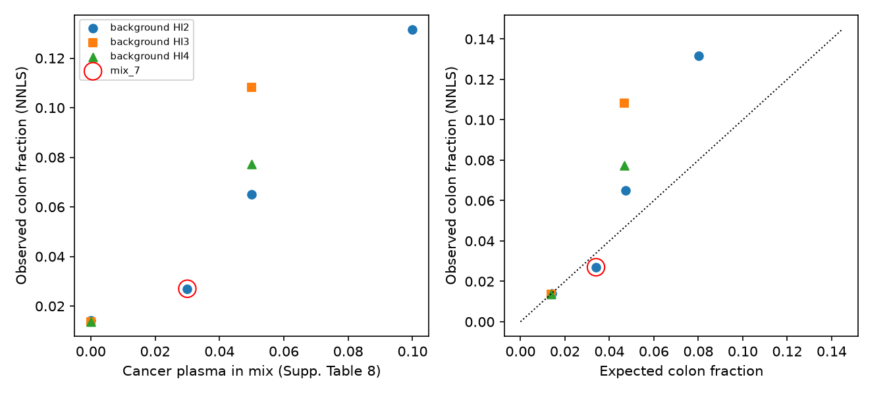
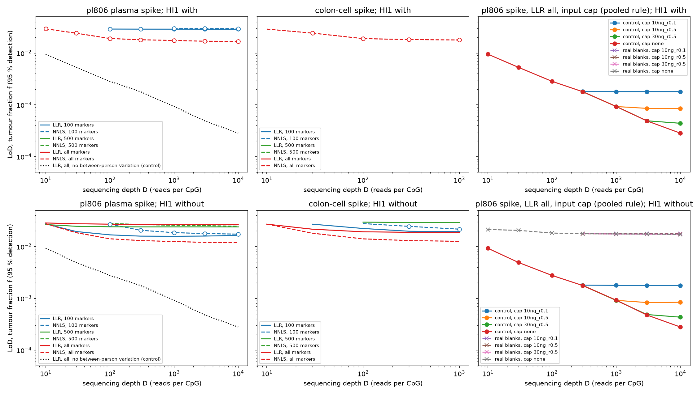
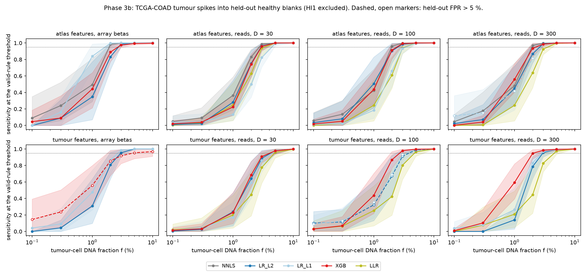
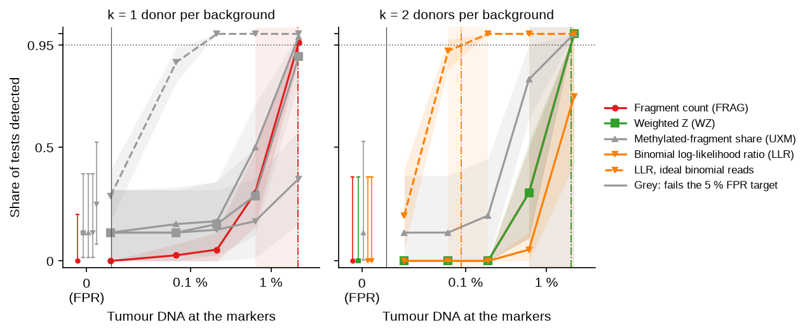
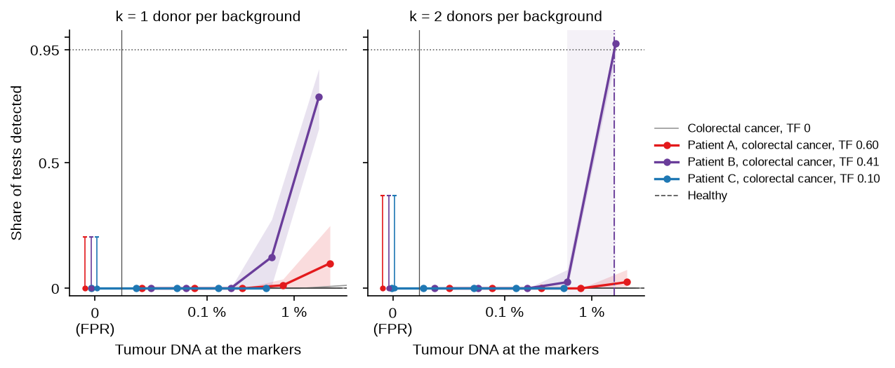

# Detailed methods and results

This page holds the detail behind the [README](../README.md): the spike-in design per
phase, the controls, the results of every phase with their figures, and the limitations.
All values come from the tables under `results/`.

## Terms

| Term | Meaning |
|---|---|
| cfDNA | Cell-free DNA: short DNA fragments that circulate in blood plasma |
| Blank | A healthy sample with no tumour DNA |
| Spike, spike-in | Tumour (or cancer-plasma) DNA mixed into a healthy background at a known fraction |
| f | Spike fraction: the share of DNA (array phases) or of fragments (read phases) that comes from the spike |
| Effective share | The share of fragments at the marker blocks that comes from the spike. It is lower than f, because the spike covers the markers less well |
| TF | Tumour fraction: the share of a patient's cfDNA that comes from the tumour, estimated from copy-number changes |
| LoD_tumour | LoD × TF: the LoD on the scale of tumour DNA, for a patient-plasma spike |
| LoB, limit of blank | The 95th percentile of a score over blanks (CLSI EP17-A2) |
| LoD, limit of detection | The lowest f detected in at least 95 % of tests, interpolated on log f |
| FPR | False-positive rate: the share of spike-free tests scored above the threshold. The target is 5 % or less |
| k | Pool size: the number of healthy donors whose reads form one background |
| Block | A 500 bp window around a marker CpG |
| Marker sets | "atlas": 5,258 CpGs of the Moss et al. 2018 cell-type atlas (3,550 blocks). "tumour": the top 500 TCGA colorectal-tumour CpGs (358 blocks) |
| NNLS | Non-negative least-squares deconvolution against the Moss atlas; gives a colon-cell share |
| LLR | Log-likelihood ratio of "tumour at fraction f" against "background only", summed over marker CpGs |
| UXM | Share of fragments with 3 or more CpG calls in a tumour block that are all methylated |
| FRAG | Count of fragments with 3 or more calls that all match the tumour direction, in blocks that are quiet in healthy plasma, minus the expected count, as a Z score |
| WZ | Weighted Z score of block methylation, with block weights from the variance between healthy donors |
| Censored | An LoD known only to lie above the top of the tested f range |

## Spike-in titration

Every phase uses the same idea: mix a known share f of tumour signal into healthy
backgrounds, then ask at which f a score crosses a threshold set on healthy samples only.

| Phase | Background | Spike | f grid |
|---|---|---|---|
| 1–2, arrays | 12 healthy EPIC blanks | Colon-cancer plasma pl806, or colon cells | 0–10 % |
| 3, simulation | Blank betas drawn as Binomial(D, beta) reads at depth D | Colon-cancer plasma or colon cells | 0–10 % |
| 3b, classifiers | Held-out blanks | 276 TCGA-COAD tumours | 0–10 % |
| 5–6, real reads | Pools of k = 1, 2, 4, 8 healthy SPOT-MAS donors | HCT116 fragments | 0, 0.1, 0.3, 1, 3, 10 % |
| 6, patient plasma | The same pools | Fragments of one GSE186007 run | 0, 0.1, 0.3, 1, 3, 10 % |

In the read phases, mixing is done on real fragments at the marker blocks, after duplicate
removal. f counts fragments in 2,000 random off-marker windows, so it does not depend on
marker coverage. Each condition has 5 random seeds per background pool.

## Controls and guards against bias

| Control | Purpose |
|---|---|
| Threshold donors vs eval donors | 14 healthy donors set every threshold and every fitted value. The other 16 donors serve only as test backgrounds. No eval donor is ever used to fit anything |
| Threshold rule | One-sided 95 % normal prediction bound over threshold-donor pools of the same k |
| Held-out FPR | Spike-free (f = 0) eval tests give the false-positive rate of each threshold |
| Ideal binomial rung | The same tests, with reads redrawn as independent binomial calls. It shows how much of the LoD is lost to real-read effects |
| Length-matched spike | HCT116 fragments chosen to match the insert sizes of plasma. It tests whether fragment length drives detection (it does not) |
| Healthy-plasma spikes (HEA) | The 4 healthy GSE186007 runs, spiked like the cancer runs. They test for a library-protocol effect |
| Batch control | A classifier on technical fragment features (insert size, mapping quality) checks for a spike-vs-background batch signal |
| Pre-registration | `pipeline/PREREGISTERED.md` and `pipeline/PREREGISTERED_PHASE6.md` fix the rules before scoring. The Phase 6 scoring script refuses to run if these files or the scoring code are uncommitted or changed |
| Leakage tests | No person or tumour is in both a training and a test fold. The tests fail on deliberate leaks |

## Results

### Phases 1–3: the array result and the depth simulation



Figure S1. Fig. 7d of Moss et al. 2018, reproduced from the public arrays. Left: NNLS colon
fraction against the share of cancer plasma in the mix. Right: observed against expected
colon fraction. All 8 points match the published figure within 0.15 percentage points.

| Phase | Result |
|---|---|
| 1, reproduce Fig. 7d | Match within 0.15 percentage points; r = 0.940 (paper: 0.92) |
| 2, array LoB and LoD | 95 % detection needs about 2.0–2.3 % colon DNA (about 3.0–3.4 % pl806 plasma) |
| 3, depth simulation | The LoD stays at 1.2–3.0 % from D = 100 reads per CpG up; 3 of 41 cells are not reached by the 3 % top of the simulation grid, and 7 more cells fail the FPR target (`results/phase3/lod.tsv`: valid rule, HI1 excluded, both spikes) |



Figure S2. LoD against simulated depth D. Top row: blank HI1 included. Bottom row: HI1
removed. Left: plasma spike. Middle: colon-cell spike. Right: LLR on all markers with an
input cap, under an earlier pooled threshold rule. Open circles: FPR above 5 %, so that LoD
is not valid. Dotted "control" lines: no between-person variation. Without between-person
variation, the LoD falls with depth. With real blanks, it stays flat.

### Phase 3b: trained classifiers against untrained scores

TCGA-COAD tumours are spiked into held-out blanks. HI1 is excluded from these values; with
HI1, no model meets the 5 % FPR target.

| Model | LoD, % tumour-cell DNA | Held-out false positives |
|---|---|---|
| Logistic regression, L1 penalty, array | 1.6 at the fixed seed; 0.9–1.7 across 7 seeds | 0 of 11 people |
| NNLS, array and reads from D = 100 up | 1.9–2.0 | within the 5 % target |
| Trained models, reads from D = 100 up | 2.2–3.4 | see `results/phase3b/lod.tsv` |

XGBoost does not beat logistic regression consistently (largest AUC gap +0.07). Part of its
gain on tumour features is colon-tissue signal: TCGA normal-colon spikes are called too.



Figure S3. Sensitivity against f, HI1 excluded. Top row: atlas features. Bottom row: tumour
features selected inside each training fold. Columns: array betas, then simulated reads at
D = 30, 100 and 300. Bands: 95 % bootstrap interval over people. Dashed lines with open
markers: held-out FPR above 5 %. Dotted line: 95 %.

### Phases 5–6: real reads, cell-line spike

HCT116 fragments are mixed into pools of real healthy SPOT-MAS reads. Values are for the
tumour marker set (`results/phase5/lod.tsv`, `results/phase6/lod.tsv`).



Figure S4. Share of tests detected against tumour DNA at the markers (the pre-registered
effective share), tumour marker set, k = 1 and 2 donors per background. Solid lines: real
reads. Dashed line: the same tests with reads redrawn as ideal binomial calls (LLR only).
Bands: 95 % donor-bootstrap intervals (`scripts/bootstrap_lod.py`). Left of the axis break:
the false-positive rate at f = 0 with its 95 % Clopper-Pearson interval. Dash-dot lines: the
LoD; shaded: the grid points around it. Grey curves fail the 5 % FPR target and get no LoD:
UXM, WZ and LLR at k = 1 (2 of 16 spike-free tests), the ideal-binomial LLR at k = 1 (4 of
16), and UXM at k = 2 (1 of 8). At k = 2, the WZ (squares) and FRAG curves coincide. Dotted
line: 95 %.

| Score | k | LoD, nominal f | LoD, effective share | Eval FPR |
|---|---|---|---|---|
| LLR_binom, ideal binomial reads | 2 | 0.45 % | – | 0 of 8 |
| LLR_binom, real reads | 1 and 2 | not reached at f ≤ 10 % | – | 2 of 16; 0 of 8 |
| UXM (Phase 5) | 1 | 9.1 % | – | 2 of 16 |
| UXM (Phase 5) | 2 | 7.4 % | – | 1 of 8 |
| FRAG (Phase 6) | 1 | 9.8 % | 2.15 % | 0 of 16 |
| FRAG (Phase 6) | 2 | 9.2 % | 2.01 % | 0 of 8 |
| WZ (Phase 6) | 1 | not reached at f ≤ 10 % | – | 2 of 16 |
| WZ (Phase 6) | 2 | 9.2 % | 1.60 % (share of CpG calls) | 0 of 8 |

- Real reads cost more than an order of magnitude against the binomial model. Both runs use
  the same calls per block, so the gap comes from the real fragments: co-methylation within a
  fragment and between-person variation. `results/phase5/gap_attribution.tsv` splits it.
- FRAG reaches the same LoD as UXM at a lower FPR. Every finite LoD lies between the grid
  points 3 % and 10 %, so the grid cannot rank scores within that interval.
  WZ at k = 1 does not reach 95 % at f ≤ 10 %.
- With every score's threshold set at its highest spike-free eval score (matched FPR,
  `results/phase6/matched.tsv`), the LoDs are UXM 9.7 % and 8.3 %, FRAG 9.7 % and 7.7 %, at
  k = 1 and 2. The scores stay within the same grid interval.
- The length-matched spike detects like the full spike at f = 3 % (tumour set, k = 1 and 2:
  0.28–0.43 vs 0.29–0.30). Fragment length does not drive detection. It has too few
  fragments to test f = 10 %.
- Other Phase 6 tables: `fpr.tsv`, `effective_share.tsv` and `effective_share_mean.tsv`
  (spike share per test), `confound_calls.tsv` (calls per fragment, spike vs donors),
  `unscored.tsv` (cells without enough length-matched fragments), `external.tsv`. The file
  `eval_run_sha.txt` names the commit of the scoring code.
- The 10 breast cancers are not separated from healthy donors (AUC 0.36–0.45). The markers
  come from colorectal tumours, so this check has little power. It is not a positive control.

#### Donor-bootstrap intervals

The 5 seeds of a test redraw only the spike fragments, so the independent unit is the eval
pool: 16 donors at k = 1, 8 disjoint donor pairs at k = 2. `scripts/bootstrap_lod.py`
resamples pools with replacement (2,000 replicates), keeps each pool's seeds together, and
holds the thresholds fixed. The grid interval does not interpolate: it brackets the grid
points around the LoD over 95 % of replicates. The interpolated interval assumes a straight
line on log f across the 3–10 % gap, so it shows donor sampling only. Quote the grid
interval. Values: tumour DNA at the markers (`results/bootstrap/lod.tsv`).

| Spike, score | k | LoD | 95 % grid interval | 95 % interpolated interval | Replicates censored |
|---|---|---|---|---|---|
| HCT116, FRAG | 1 | 2.15 % | 0.63 % to above the grid top | 1.96 % to above the grid top | 27 % |
| HCT116, FRAG | 2 | 2.01 % | 0.61–2.20 % | 1.93–2.05 % | 0 % |
| Patient B, FRAG | 2 | 1.81 % | 0.52 % to above the grid top | 1.75 % to above the grid top | 7.6 % |

### Phase 6: real reads, patient-plasma spike

Each GSE186007 run is spiked into the same pools as HCT116. TF comes from arm-level copy
number in 1 Mb read-depth bins (`scripts/phase6_tf.py`).

| Name in figures | Run | Group | TF | Altered chromosome arms |
|---|---|---|---|---|
| Patient A | SRR24725517 | CRC | 0.60 | 18 |
| Patient B | SRR24725519 | CRC | 0.41 | 22 |
| Patient C | SRR24725520 | CRC | 0.10 (95 % interval includes 0) | 1 |
| – | 5 other CRC runs | CRC | 0 | 0 |
| – | 4 runs | HEA | 0 | 0 |



Figure S5. Share of tests detected against tumour DNA at the markers (the run's effective
share times its TF) for each GSE186007 run used as the spike. FRAG score, tumour marker set,
bound threshold rule, k = 1 and 2. Coloured: patients A, B and C (the CRC runs with TF above
0), with 95 % donor-bootstrap bands, the FPR at f = 0 and, for patient B at k = 2, the LoD
and its grid bracket. Grey: CRC runs with TF 0, drawn at the spike's effective share (an
upper bound). Dashed: healthy runs. Dotted line: 95 %.

Primary endpoint: FRAG, tumour set, the 3 CRC runs with TF above 0
(`results/phase6_gse/lod_run.tsv`, `lod_summary.tsv`).

| k | Runs with a finite LoD | SRR24725519 LoD (f) | Median LoD_tumour over the 3 runs | HCT116 effective share at LoD |
|---|---|---|---|---|
| 1 | 0 of 3 | above 10 % (censored) | at least 4.09 % (all 3 censored) | 2.15 % |
| 2 | 1 of 3 | between 3 % and 10 % | at least 1.2 % (2 of 3 censored; 3.96 % with the interpolated LoD) | 2.01 % |

- At k = 2, patient B (SRR24725519) jumps from 1 of 40 tests detected at f = 3 % to 39 of 40 at f = 10 %
  (donor-bootstrap 95 % interval 0.925–1.00, over 8 donor pairs). The LoD can lie anywhere between those grid points. The value
  interpolated on log f is 9.7 % (LoD_tumour 3.96 %). Only the grid bracket is
  certain, so the median over the 3 runs is bounded below by 0.03 × TF 0.409 = 1.2 %. Its effective
  share at the LoD is at most 1.88 %. So the patient run and HCT116 cannot be told apart.
- SRR24725517 has the highest TF but is rarely detected. Its reads cover the tumour blocks
  as well as SRR24725519, so depth is not the cause. Its tumour may not share the methylation
  pattern of the TCGA-derived markers.
- Healthy-plasma spikes are never detected with FRAG, at any k or f. The protocol difference
  (LABS vs SPOT-MAS) does not create false tumour signal on the tumour set.
- Scored on their own, without a background, the runs separate partly on the tumour set:
  FRAG calls 2 of 8 CRC and 0 of 4 HEA (95 % upper bound 0.60), AUC 0.875. On the atlas set,
  all 4 healthy runs are called. That is a protocol effect, so the atlas set does not transfer
  between protocols.

## Earlier phases: how to run

The array phases (1–3b) need the array downloads in `data/` (for example
`bash data/download_geo.sh`).

```bash
uv run python scripts/phase1_fig7d.py                  # reproduce Moss et al. 2018, Fig. 7d
uv run python scripts/phase2_lob_lod.py                # array LoB and LoD
REPO_DIR=$PWD CFDNA_DATA=<data dir> sbatch --array=0-42 scripts/phase3_depth_sim.sbatch
uv run python scripts/phase3_summary.py                # depth simulation
REPO_DIR=$PWD CFDNA_DATA=<data dir> STEP=prepare sbatch scripts/phase3b.sbatch
REPO_DIR=$PWD CFDNA_DATA=<data dir> sbatch --array=0-15 scripts/phase3b.sbatch
uv run python scripts/phase3b_summary.py               # trained classifiers
```

Every simulation and model uses a fixed seed (the `SEED` constant of each script).

## Limitations

- **Few people.** Every FPR rests on 16 spike-free eval tests at k = 1 and 8 at k = 2. For 0
  of 16, the 95 % interval reaches 21 % (`fpr_hi95` in `results/phase6/lod.tsv`). The array phases rest on 11 people in 7 groups.
- **Coarse f grid.** Between 3 % and 10 % there is no grid point. An interpolated LoD in that
  range carries false precision.
- **Censored LoDs.** In the patient arm most LoDs lie above the top of the grid. Medians are
  therefore given as lower bounds.
- **One cell line.** HCT116 is CIMP-high, so it is more methylated at these markers than a
  typical colon tumour. Detection of typical tumours may be worse.
- **TF from copy number only.** Runs without copy-number changes get TF 0 even if they carry
  tumour DNA. The TF of SRR24725520 rests on one arm.
- **f differs between phases.** Phases 2–3 spike colon plasma or colon cells; Phase 3b spikes
  TCGA tumour cells; Phases 5–6 spike fragments.
- **Array processing.** TCGA betas (SeSAMe) and GEO betas (minfi) are processed differently.
  The median offset at the atlas CpGs is 0.028.

